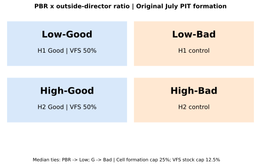
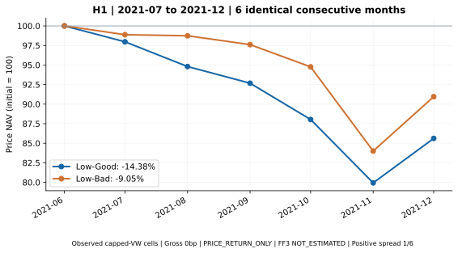
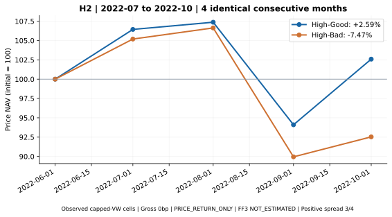
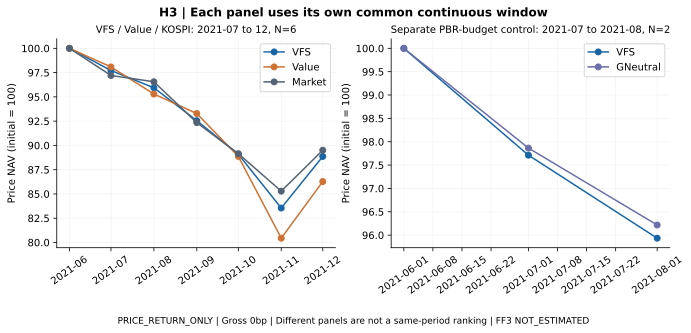
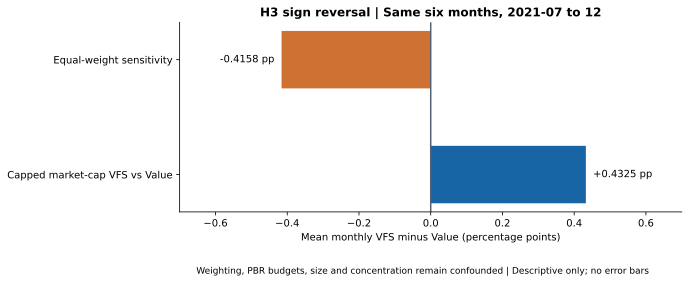

# VFS: 세 가지 핵심 투자 가설의 실증

독립 개인 Quant/ESG 연구 · 2026-10-11 KST · 탐색적 확장 · PRICE_RETURN_ONLY

## Executive Summary

기업의 가치평가(PBR)에 거버넌스 정보를 결합하면 저평가 기업의 가치 함정을 구분하고 고평가 기업을 선별하며 투자 포트폴리오를 개선할 수 있는가?

| 핵심 가설 | 비교군 | 결과 | 실증 판정 |
| --- | --- | --- | --- |
| H1 가치 함정 구분 | Low-Good vs Low-Bad | 6개월 누적 -14.38% / -9.05%; 월평균 차이 -1.0340%p | INSUFFICIENT_EVIDENCE |
| H2 고PBR 선별 | High-Good vs High-Bad | 4개월 누적 +2.59% / -7.47%; 월평균 차이 +2.5481%p | INSUFFICIENT_EVIDENCE |
| H3 VFS 포트폴리오 | VFS vs Value / G-neutral / KOSPI | Value 공통 6개월 -11.14% / -13.72%; 월평균 차이 +0.4325%p; EW -0.4158%p | MIXED_EVIDENCE |

H1은 짧은 가격수익률 비교에서 가설 방향과 반대였고, H2는 가설 방향과 같았습니다. 두 표본 모두 24개월 최소기간에 못 미쳐 경제적 가설 판정은 INSUFFICIENT_EVIDENCE입니다. H3는 Value 대비 양수 차이가 동일가중에서 음수로 바뀌어 MIXED_EVIDENCE입니다. 미추정은 통계적으로 비유의한 결과나 효과 0과 다릅니다.

새 기여는 네 셀의 실제 보유경로, 셀별 결측 감사, 형성 특성, 관측 단면 및 12개월 후속 가격 손실을 계산한 것입니다. 이는 기존 결과를 알고 구성한 탐색적 확장입니다.

## Research Design

기존 적격기업을 7월에 형성합니다. 6월 말까지 공개된 G·장부자본과 lagged ME로 PBR 중앙값을 나누며 동점은 Low, 각 PBR군의 G 중앙값 동점은 Bad입니다. G는 사외이사/전체 이사 비율이며 원문의 MSCI 거버넌스 점수와 다릅니다.

네 셀은 형성 시 시가총액 가중 및 종목 25% 상한을 적용합니다. VFS는 Low-Good 50% + High-Good 50%로 최종 종목 상한 12.5%를 유지합니다. 형성 후에는 연간 보유와 비중 드리프트를 적용합니다. 보유수익률 하나라도 결측이면 해당 셀의 연간 경로를 다음 형성까지 중단하며 결측을 채우거나 재선정하지 않습니다.

모든 실측 수익률은 PRICE_RETURN_ONLY, gross 0bp입니다. 각 가설의 가장 긴 공통 연속기간을 독립적으로 보고합니다. 단면 탐색은 최초 형성의 구성원을 계속 추적해 관측된 종목 수익률만 요약하므로 투자 가능한 NAV가 아닙니다.

원천 G 4,540건·재무 4,382건·증빙 객체 9,186개를 재검증했습니다. PIT 결합 782기업·38,742개 적격 주식-월입니다. 원문 2016–2020년의 결합 PIT 공백은 남습니다. 기존 분석계획과 해시는 보존했습니다.

## H1 — Does Governance Differentiate Value Traps?

**2021-07~2021-12, 공통 6개월.** Good -14.3847%, Bad -9.0482%, 월평균 Good−Bad -1.0340%p. 차이가 양수인 월 1/6, 음수인 월 5/6입니다.

| 표본 단위 | Good | Bad |
| --- | --- | --- |
| 같은 기간 형성 기업 수 | 150 | 183 |
| 같은 기간 보유 기업-월 | 900 | 1098 |

| 형성 특성 (관측 종목 평균) | Good | Bad |
| --- | --- | --- |
| PBR 중앙값 | 0.687 | 0.677 |
| 시총 중앙값 (십억원) | 496.40 | 209.26 |
| ROE 평균 / 가용 기업 | 2.48% / 148 | 2.61% / 182 |

별도 관측 단면은 58개월의 월별 종목 평균을 비교했습니다. 월평균 Good−Bad +0.1315%p, 양수 월 29, 음수 월 29. 월평균 결측률은 Good 0.188%, Bad 0.511%입니다. 모든 월을 투자 가능한 셀 수익률로 연결한 결과가 아닙니다. 규모 3분위·형성연도·PIT ROE별 결과와 PBR 분포는 별도 집계 CSV로 공개합니다.

탐색적 가치 함정 결과변수는 형성 후 12개월 가격 누적손실 ≤-30%입니다. 모든 12개월 수익률을 관측한 종목만 계산하며 결측과 2025년 형성군의 우측 검열을 별도 보고합니다. 종목 생존·기업행동 선택편향 때문에 가치 함정을 회피했다는 인과 결론은 내리지 않습니다. 후속 수익성 악화는 독립 검증된 일관된 재무 시계열이 없어 NOT_TESTED입니다.

| 셀 | 형성 기업·연도 | 완전한 12개월 경로 | 우측 검열 | 결측/비정상 | -30% 이하 손실(완전 경로) |
| --- | --- | --- | --- | --- | --- |
| Low-Good | 756 | 598 | 154 | 4 | 105/598 (17.56%) |
| Low-Bad | 893 | 714 | 168 | 11 | 103/714 (14.43%) |
| High-Good | 738 | 579 | 147 | 12 | 141/579 (24.35%) |
| High-Bad | 908 | 717 | 174 | 17 | 218/717 (30.40%) |

Low-Good 손실률은 완전 경로 105/598 (17.56%), Low-Bad는 103/714 (14.43%)입니다. 2021–2024년의 4개 형성군 모두 Good의 손실률이 더 높아 이 가격손실 대리지표도 가치 함정 회피를 뒷받침하지 않았습니다. 이는 독립 기업 N에 대한 유의성 검정이 아니며 재무 악화·경제적 상폐 손실을 포괄하지 않습니다.

관측된 가장 긴 Low-PBR 비교는 Good가 열위였습니다. 다만 6개월 방향을 장기 가치 함정 가설의 기각이나 비유의 검정으로 해석하지 않습니다.

판정: **INSUFFICIENT_EVIDENCE**. FF3·HAC3/6·95% CI는 **NOT_ESTIMATED**.

## H2 — Does Governance Differentiate High-PBR Firms?

**2022-07~2022-10, 공통 4개월.** Good +2.5935%, Bad -7.4670%, 월평균 Good−Bad +2.5481%p. 차이가 양수인 월 3/4, 음수인 월 1/4입니다.

| 표본 단위 | Good | Bad |
| --- | --- | --- |
| 같은 기간 형성 기업 수 | 124 | 177 |
| 같은 기간 보유 기업-월 | 496 | 708 |

| 형성 특성 (관측 종목 평균) | Good | Bad |
| --- | --- | --- |
| PBR 중앙값 | 1.416 | 1.433 |
| 시총 중앙값 (십억원) | 1175.62 | 245.57 |
| ROE 평균 / 가용 기업 | 3.10% / 120 | -1.86% / 170 |

별도 관측 단면은 58개월의 월별 종목 평균을 비교했습니다. 월평균 Good−Bad +0.4678%p, 양수 월 32, 음수 월 26. 월평균 결측률은 Good 0.575%, Bad 0.814%입니다. 모든 월을 투자 가능한 셀 수익률로 연결한 결과가 아닙니다. 규모 3분위·형성연도·PIT ROE별 결과와 PBR 분포는 별도 집계 CSV로 공개합니다.

Good의 양수 차이는 고PBR군 내부의 관측된 가격수익률 정보입니다. PBR·규모·ROE 차이와 단면 선택편향이 남으며, 적정 PBR이나 자기자본비용(COE)의 인과적 정당화는 검정하지 않았습니다. H1의 2021년 결과와 H2의 2022년 결과도 같은 시장기간의 효과 크기처럼 비교하지 않습니다.

판정: **INSUFFICIENT_EVIDENCE**. FF3·HAC3/6·95% CI는 **NOT_ESTIMATED**.

## H3 — Does VFS Improve Portfolio Outcomes?

기존 VFS 결과와 주 분석은 그대로입니다. VFS 자체 2021-07~2022-02의 8개월 누적 -17.30%와 비교군 공통 6개월은 별도 표본입니다.

| 2021-07~12 / N=6 | 누적 | 월수익률 연환산 변동성* | MDD |
| --- | --- | --- | --- |
| VFS | -11.14% | 14.95% | -16.46% |
| Value | -13.72% | 18.94% | -19.56% |
| Market | -10.50% | 12.35% | -14.72% |

VFS−Value 월평균 +0.4325%p. PBR 50:50 G-neutral과 VFS의 별도 공통기간은 2021-07~2021-08, 2개월이며 누적 -4.0659% / -3.7833%, 월평균 차이 -0.1441%p입니다. 서로 다른 기간의 누적치를 동일 성과 순위로 나열하지 않습니다. *짧은 표본의 연환산 변동성은 진단값입니다.

동일 6개월 동일가중에서는 월평균 차이 -0.4158%p로 부호가 역전됐습니다. 형성연도별 G와 log(ME)의 상관은 0.3945~0.4731입니다. VFS는 Low/High 예산·셀 상한·시총가중이 Value와 달라 순수 G 효과를 분리하지 못합니다. H1/H2의 형성 진단은 PBR 분포·규모·ROE·HHI·유효 종목수·결측률도 기록합니다. G-neutral은 PBR군 예산만 맞춘 비교군이며 연속 PBR와 규모까지 같지 않습니다.

거래비용 10/30bp는 기존 one-way 매수+매도 가정과 회전율에 따른 민감도로 남깁니다. 경로 중단 후 이전 비중이 불명확하면 재형성 비용도 NA입니다. 독립 규모 매칭 전략은 소수 형성군·기업행동·결측 제약으로 추가하지 않았으며 규모 층화는 탐색 단면 진단으로 제공합니다.

판정: **MIXED_EVIDENCE**. Value 대비 제한적 양수 차이와 EW 부호 반전이 공존합니다. 장기 투자성과·거버넌스 증분 알파는 INSUFFICIENT_EVIDENCE이며 FF3 알파는 NOT_ESTIMATED입니다.

## Conclusion & Limitations

H1·H2를 실제 원천에서 계산했지만 가치 함정 회피, 정당한 프리미엄, 장기 G 알파를 입증하지 못했습니다. H3의 양수 spread도 가중 방식에 의존했습니다. 연구의 기여는 유리한 결과를 선택하는 데 있지 않고, 비교군·관측기간·결측·혼동요인을 일관되게 검증하는 데 있습니다.

단면 자료는 782개 고유 기업, 38,254개 기대 기업-월, 38,050개 관측 기업-월, 58개 달, 5개 연간 형성군입니다. 반복 기업-월을 독립 표본으로 취급하지 않습니다. 월 고정효과·Good·log(ME)·연속 PBR·PIT ROE의 기업/형성군 이중 군집 검정 코드를 구현했지만 형성군 5개가 사양의 최소 10개에 못 미쳐 실제 계수·p·CI는 미추정입니다. 58개월의 선택된 단면을 58개월 투자 가능한 전략으로 바꾸거나 FF3의 24개월 조건을 우회하지 않았습니다.

2016–2020년 PIT 공백, 원문 MSCI G와의 차이, 배당·상폐 대가·기업행동, 전체 역사적 모집단, 정정 이전 공시, 독립 OOS는 미검증입니다. 기존 보유 결측 11개 사건에 대해 16개 접수번호·37개 공식 본문 절을 조사했으나 경제적 수익률 수정은 0건입니다. 2021년 12월 권리 전환과 형성 전 거래정지 때문에 관측 가격 NAV의 투자 가능성도 확정하지 못했습니다.

추정 가능한 셀·spread의 HAC3/6 총 16개 사양에는 Holm 보정을 적용하는 코드가 있고 이번에는 전부 미추정입니다. 단면 2개 계수 검정은 별도 탐색 가족으로 관리합니다. 개별 95% CI를 동시 신뢰구간으로 주장하지 않습니다.

## Appendix

원문의 목차별 해설과 기존 실증·감사를 보존한 [이전 메인 보고서](snapshots/pre-core-hypotheses-f0cf8db/reports/RESEARCH_REPORT.pdf), [기존 README](snapshots/pre-core-hypotheses-f0cf8db/README.md), [기술 감사 대시보드](dashboard/appendix.html)를 함께 제공합니다.

| 보존 자료 | 문서 |
| --- | --- |
| 원문 목차·개혁·반도체·COE/적정 멀티플 | [원문 대응표](docs/REPORT_TO_IMPLEMENTATION_MAP.md) · [원문/구현 차이](docs/ORIGINAL_VS_IMPLEMENTATION.md) |
| 과거 공시·PIT·원천 재구축·SHA256 | [재구축](docs/PUBLIC_SOURCE_REBUILD.md) · [원천 영수증](outputs/reconstruction/recollected_input_manifest.json) |
| 기업행동·상폐·11개 결측 사건 | [경제적 수익률 감사](docs/ECONOMIC_RETURN_RECOVERY.md) · [수정 0건](outputs/final/return_repair_status.csv) |
| FF3·강건성·설계 잠금·기존 결과 | [설계](config/vfs_pre_analysis_plan.yaml) · [강건성](outputs/robustness.csv) · [불변성 목록](docs/core_baseline_hashes.json) |
| 신규 탐색 계획·의사결정·재현 | [계획](config/core_hypotheses_exploratory_plan.yaml) · [이력](docs/CORE_DECISIONS.md) · [재현](docs/CORE_REPRODUCIBILITY.md) |

[핵심 집계 JSON](outputs/core_hypotheses/hypothesis_results.json) · [면접 요약](docs/INTERVIEW_BRIEF.md) · [연구 PDF](reports/RESEARCH_REPORT.pdf) · [Executive Brief](reports/EXECUTIVE_BRIEF.pdf) · [GitHub Pages](https://bucheoncityboy.github.io/mirae-governance-vfs-research/)

기존 주 분석 기준 문구: Value와 동일 조건으로 비교하는 공통 연속 기간은 2021-07~2021-12(6개월)입니다. 이 기간 누적 가격수익률은 VFS -11.14%, Value -13.72%, KOSPI -10.50%이며, VFS−Value 월평균 차이는 +0.43%p입니다.
