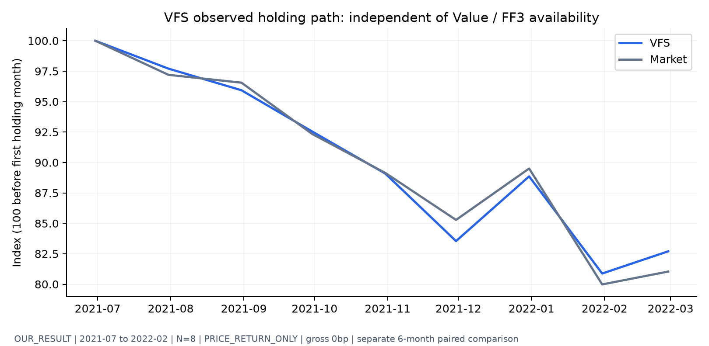
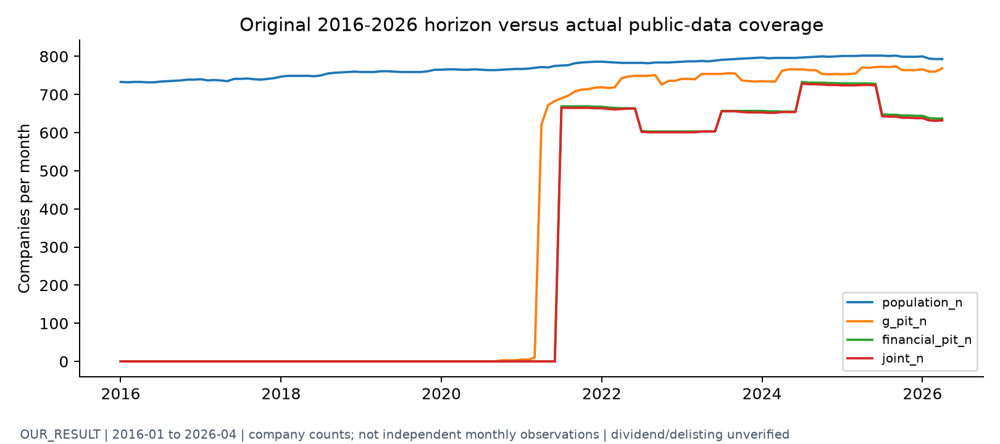
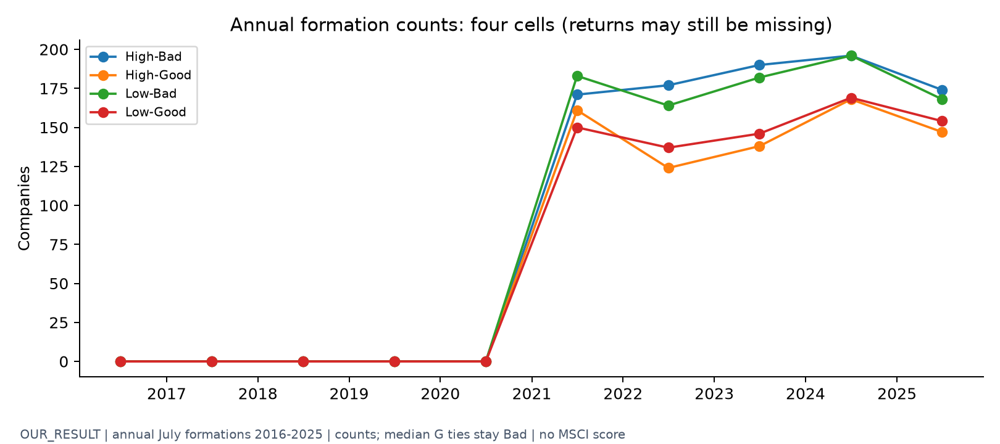
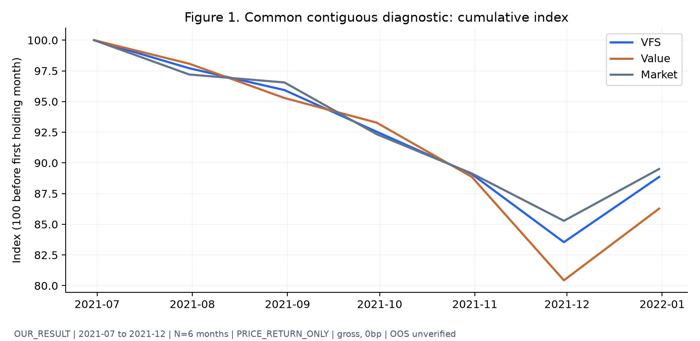
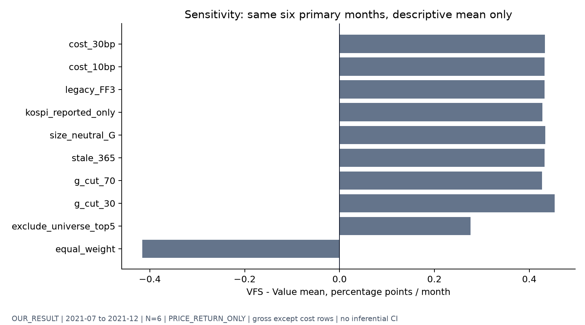
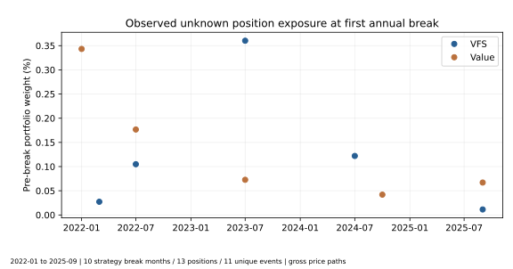
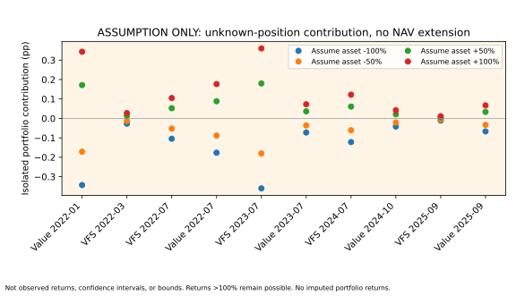
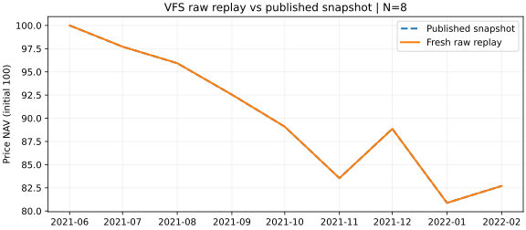
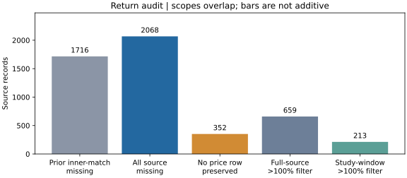

# Value Focus Style | 공시 기반 거버넌스 가치전략의 독립 재구현 및 검증

**미래에셋의 VFS 투자규칙을 실제 공시 시점에 맞춰 구성하면 어떤 수익률·위험·보유경로가 나타나는가?** 유건호 연구원의 「멀티플 탈출」(2026-05-28)을 따라 VFS 자체의 백테스트와 Value·시장 비교를 수행하는 독립 개인 연구입니다.

**한정 연구 완료: COMPLETE_LIMITED_EVIDENCE · VFS 실증 범위: EMPIRICAL_LIMITED.**

VFS 자체의 최장 연속 관측은 2021-07~2022-02(8개월)이며 누적 가격수익률은 VFS -17.30%, 같은 기간 KOSPI -18.96%입니다. Value와 동일 조건으로 비교하는 공통 연속 기간은 2021-07~2021-12(6개월)입니다. 이 기간 누적 가격수익률은 VFS -11.14%, Value -13.72%, KOSPI -10.50%이며, VFS−Value 월평균 차이는 +0.43%p입니다.

원천 PIT 결합 표본은 782기업·38,742 주식-월입니다. MSCI G 대신 사외이사 비율을 썼으며 **PRICE_RETURN_ONLY**, gross 0bp, 배당·상폐·독립 OOS 미검증입니다. FF3는 성과 해석을 위한 보조 검정으로 하단에 구분했습니다.

**2026-10-11 원천 재현 검증:** 이전 비공개 파일 없이 공식 OpenDART를 재수집해 아래 8개월·6개월 성과를 다시 실행했습니다. VFS·Value·시장의 월수익률을 대조한 결과 허용오차 1e-12를 넘는 차이는 0건입니다. 원천 SHA의 차이, 결측 감사 보완과 G-neutral 2개월 제약은 [재구축 검증](docs/PUBLIC_SOURCE_REBUILD.md)과 [PDF 검증 부록](reports/PUBLIC_SOURCE_REBUILD_APPENDIX.pdf)에서 각각 설명했습니다. 기존 원문 대응 본문과 성과 스냅샷을 보존했습니다.

[공식 원문 PDF](https://securities.miraeasset.com/bbs/maildownload/20260527170512707_154) · [독립 연구보고서](reports/RESEARCH_REPORT.pdf) · [Executive Brief](reports/EXECUTIVE_BRIEF.md) · [VFS 보유경로](outputs/figures/vfs_observed.png) · [배포 대시보드](https://bucheoncityboy.github.io/mirae-governance-vfs-research/) · [재현 방법](docs/REPRODUCIBILITY.md)

읽는 순서: 원문 배경 p5 → 가치평가 가설 p10 → 스타일 비교 p17 → **[VFS 규칙 p20](#04-rebuilding-the-vfs-strategy)** → **[원문과 실증 p21-23](#05-original-results-vs-our-backtest)** → **[다기간 검증 p28](#06-alpha-regimes--robustness)** → 결론 p25. [전체 목차·근거 매핑](docs/REPORT_TO_IMPLEMENTATION_MAP.md)은 p2의 모든 항목과 본문 표·그림을 연결합니다.

## 00. Research Question & Findings

**원문 (p3 Executive Summary)** — 저PBR만으로는 가치 함정을 구분하기 어려워 거버넌스가 우수한 저PBR와 고PBR 기업을 함께 담는 전략을 제안합니다.

**우리의 구현** — 같은 모집단에서 VFS와 Value를 비교하고 수익률 차이와 FF3 조정 차이를 분리했습니다. 결과를 보기 전 [설계 커밋](https://github.com/bucheoncityboy/mirae-governance-vfs-research/commit/09a105ce651bc28eaad1e0993b12678a41acf61f)을 남겼지만 이전 G 연구를 알고 있었으므로 탐색 연구입니다.

**실증 결과** — VFS 자체의 최장 연속 관측은 2021-07~2022-02(8개월)이며 누적 가격수익률은 VFS -17.30%, 같은 기간 KOSPI -18.96%입니다. Value와 비교할 때는 두 전략에 동일한 조건을 적용했습니다. 공통 연속 기간은 2021-07~2021-12(6개월)입니다. 이 기간 누적 가격수익률은 VFS -11.14%, Value -13.72%, KOSPI -10.50%이며 VFS−Value 월평균 차이는 +0.43%p입니다.

**판정: ADAPTED / 부분 관측.** VFS 자체의 8개월 기록과 세 전략의 공통 6개월 비교는 서로 다른 분석입니다. 원수익과 보유경로를 먼저 검증하며 FF3 추정 가능 여부로 VFS 백테스트의 존재 여부를 판정하지 않습니다. [보유경로 중단 원인과 구현 가정](docs/VFS_BACKTEST_DIAGNOSIS.md).

## 01. Why Governance?

**원문 (p5 「두개의 날개, 반도체와 거버넌스 개혁」, p8)** — 반도체 이익과 거버넌스 개혁을 시장 배경으로 설명합니다.

**우리의 구현** — 이 배경에서 투자 규칙의 검증 질문을 가져왔습니다. 정책 효과나 반도체 경기의 인과효과를 재추정하지 않았습니다.

**실증 결과** — 정책 이벤트 분석 **NOT_TESTED**. [규모·G 진단](outputs/size_G_diagnostics.csv)은 이사회 비율과 기업규모의 혼동 가능성을 점검할 뿐입니다.

**판정: CONTEXT_ONLY.** 사외이사 비율은 종합 거버넌스 품질이 아니며 법정 선임요건·기업규모와 함께 움직일 수 있습니다.

## 02. From Valuation to Hypothesis

**원문 (p10 「코스피의 적정 멀티플을 찾아서」, p11·13·15)** — ROE와 COE를 연결해 적정 멀티플과 시나리오를 논의합니다.

**우리의 구현** — [공시일 PIT](src/vfs_research/pit_features.py)와 공식 재무자료로 확인한 BE를 이용해 형성 시점 PBR을 계산했습니다. COE 모형, 전망 ROE와 적정 PBR 예측은 구현하지 않았습니다.

**실증 결과** — 원시 증빙 9,186개 해시를 다시 확인했습니다. 과거 G와 재무자료가 동시에 연결되는 기간은 2021년 이후이며 [월별 커버리지](outputs/coverage_matrix.csv)에 공백을 남겼습니다.

**판정: ADAPTED PBR / NOT_TESTED COE.** 주가 상승이나 이사회 비율만으로 할인율 하락을 추론하지 않습니다.

## 03. Why Value Alone May Fail

**원문 (p17 「코스피 아웃퍼폼의 조건」, p18)** — 단일 가치·성장 스타일의 한계와 시장 반응을 다룹니다.

**우리의 구현** — [연간 백테스트](src/vfs_research/backtest.py)에서 같은 G·BE 적격기업, 같은 형성일과 수익률 데이터로 저PBR Value를 만들었습니다. Value는 시총가중이며 VFS와 다르게 상한을 추가하지 않았습니다.

**실증 결과** — 아래 표는 실제 공통기간 2021-07~2021-12, 월 N=6, 배당 미포함 gross 0bp입니다.

| 전략 (OUR_RESULT) | 6개월 누적 | 연환산 CAGR* | 연환산 변동성* | Sharpe* | 월간 MDD |
| --- | ---: | ---: | ---: | ---: | ---: |
| VFS | -11.14% | -21.04% | 14.95% | -1.54 | -16.46% |
| Value | -13.72% | -25.57% | 18.94% | -1.49 | -19.56% |
| Market | -10.50% | -19.89% | 12.35% | -1.77 | -14.72% |

*CAGR·변동성·Sharpe·Sortino는 월자료를 연환산한 6개월 진단치입니다. 장기 기대수익률을 의미하지 않습니다. MDD는 첫 투자 직전 NAV=1을 포함합니다.*

**판정: ADAPTED.** 이 표로 원문 2016-2026년 가치전략의 부진을 검증했다고 주장할 수 없습니다.

## 04. Rebuilding the VFS Strategy

**원문 (p20 표6, p21 투자규칙)** — PBR×G 네 셀 중 Low-Good과 High-Good을 각각 절반씩 담고 셀 안의 종목 비중을 25%로 제한합니다.

**우리의 구현** — [분류](src/vfs_research/sorts.py)와 [수렴하는 상한 재배분](src/vfs_research/portfolio.py)을 구현했습니다. 6월 말까지 공개된 연간 자료로 7월 수익률부터 투자하며 PBR 중앙값과 각 PBR군 내부 G 중앙값은 **우리 가정**입니다. 동점은 Low/Bad에 모두 남겨 인위적으로 쪼개지 않았습니다.

**실증 결과** — [연간 셀 기업수](outputs/cell_formation_coverage.csv)와 [형성 비중·거래량](outputs/formation_summary.csv)을 공개했습니다. 25%/12.5%는 형성 시점에 검증했으며 연중 보유비중의 드리프트는 월별 집계에 별도로 남겼습니다. 결측 보유종목을 사후 제외하면 다른 포트폴리오가 되므로 해당 연간 경로를 중단했습니다.

**판정: REIMPLEMENTED 규칙 / ADAPTED 입력.** MSCI의 다차원 점수와 사외이사 비율의 의미는 다릅니다. 원문 완전 재현이 아닙니다. [원문과 구현 구분](docs/ORIGINAL_VS_IMPLEMENTATION.md), [가정](docs/ASSUMPTIONS.md).

## 05. Original Results vs Our Backtest

**원문 (p21 표7·그림37-38, p22 표8-9, p23 표10)** — 원문은 2016.01~2026.04의 배당 포함 VFS 성과와 대형주·성장·가치 혼합 노출을 제시합니다.

**우리의 구현** — 성과·표본·점수·가격/총수익률 차이를 분리했습니다. 종목별 FnGuide 원천과 유료 파생자료는 재배포하지 않았고 규모·ROE·집중도 집계만 공개했습니다. 원문 편입종목이나 현재 업종을 과거로 소급하지 않았습니다.

**실증 결과**

| 평가항목 | 미래에셋 원문 REFERENCE_ONLY | 우리 OUR_RESULT | 직접 비교 가능성 |
| --- | --- | --- | --- |
| G | MSCI governance score | OpenDART 사외이사/전체 이사 | 정의 다름 |
| 수익률 | 현금배당 포함, 윈저화 | PRICE_RETURN_ONLY; 기존 가격필터 미해결 | 제한 |
| 기간/표본 | 2016.01~2026.04, MSCI 커버리지 | 2021.07~12, 6개월; 전체 PIT 결합 782기업 | 불일치 |
| VFS | 연평균 20.14%, Sharpe 0.75 | 6개월 누적 -11.14%, Sharpe -1.54* | 동일 재현 아님 |
| Value | 연평균 12.63%, Sharpe 0.50 | 6개월 누적 -13.72%, Sharpe -1.49* | 우리 내부 쌍별 비교 |
| KOSPI | 연평균 18.10%, Sharpe 0.66 | 6개월 누적 -10.50% | 불일치 |
| FF3 α / HAC p / CI | 표7에 없음 | NOT_ESTIMATED (6<24개월) | OUR EXTENSION |

*원문 연평균수익률의 정확한 산식은 확인되지 않아 CAGR로 바꾸지 않았습니다. 원문 연평균과 우리 6개월 누적값은 다른 기간·정의의 지표입니다. 수치를 나란히 둔 목적은 일치나 우위 주장이 아니라 비교 불가능한 이유를 드러내는 것입니다.*

**Figure 2 - FF3 α와 95% CI: NOT_ESTIMATED.** 표본이 부족하므로 숫자나 모의 오차막대를 그리지 않았습니다. [알파 상태 CSV](outputs/ff3_alphas.csv).

**판정: ADAPTED / NOT_ESTIMATED.** VFS의 누적손실이 Value보다 작다는 진단과, 거버넌스의 독립적 보상은 다른 주장입니다.

## 06. Alpha, Regimes & Robustness

**원문 (p28 「밸류 포커스 스타일 다기간 검증」, 그림40-42)** — 연도별 롱/롱숏 수익률과 Sharpe를 비교하며 Sharpe 그림은 RF 2%를 가정합니다.

**우리의 구현 - OUR EXTENSION** — FF3 세 회귀(VFS, Value, VFS−Value), HAC3/6, 95% CI, 블록 부트스트랩, 비용·가중·상위5 제외·G 컷·PIT 지연·규모중립 민감도를 사전 고정했습니다. spread에서 RF를 다시 차감하지 않습니다. 미완성 연도에서 결측월만 빼고 연간 수익률을 계산하지 않습니다.

이 절의 FF3는 보조 위험조정 검정입니다. 주 작업인 VFS 구성·가중·리밸런싱·원수익 백테스트는 SMB/HML 자료 없이도 실행됩니다. α·t·p·CI는 최소 24개월 미충족으로 NOT_ESTIMATED이며 이는 VFS 원수익이 존재하지 않는다는 뜻이 아닙니다.

| 원문 다기간 분석 | 우리 독립 검증 | 결과 |
| --- | --- | --- |
| 연도별 롱/롱숏 수익률 | [연간 수익률 상태](outputs/annual_returns.csv) | VFS 완전한 12개월 연도 없음 |
| 연도별 Sharpe | 12개월 rolling volatility | NOT_ESTIMATED; 공통 6개월 |
| 표7 원수익·위험지표 | [FF3 및 spread HAC](outputs/ff3_alphas.csv) | α/t/p/CI 모두 NA |
| 다기간 성과 | [등록된 11개 민감도](outputs/robustness.csv) | 모든 사양/NA 공개; 알파 미추정 |
| 독립 OOS 미제시 | Independent OOS - NOT VERIFIED | UNVERIFIED; 기존 연구 이력으로 전 기간 인지 |

**실증 결과** — [편향 감사](outputs/bias_audit.csv)와 [블록 부트스트랩](outputs/bootstrap.json)은 해결한 절차와 남은 자료 제약을 나눕니다. 생존·상폐·기업행동·배당·역사적 업종·법정 규모요건·독립 OOS는 미검증입니다. Holm 보정에 투입할 추정 가능한 알파 검정도 없습니다.

[ROE·12-1 가격 모멘텀 노출 진단](outputs/control_exposure_diagnostics.csv)은 형성 이전 자료만 쓰며 각 변수의 관측 비중을 함께 표시합니다. 이는 빠진 산업·배당·유동성 통제를 해결한 인과 검정이 아닙니다. EW 사양에서는 같은 6개월의 VFS−Value 월평균 차이가 음수로 바뀌어 성과 차이의 규모·가중 방식 의존성도 남았습니다.

**판정: NOT_ESTIMATED / OOS NOT VERIFIED.** 실패한 검증 게이트는 전략 실패의 확정도, 알파 부재의 확정도 아닙니다. 현재 자료로는 질문에 통계적으로 답할 수 없습니다.

<!-- FINAL_EVIDENCE_START -->
### 결측은 어떤 경제적 사건이었는가?

원문 p21·p28의 장기 성과와 비교하려면 종목의 가격뿐 아니라 현금·신주·거래 가능성까지 이어져야 합니다. VFS 7건과 Value 6건의 첫 보유 결측을 중복 제거한 **11개 사건**을 조사했습니다. 후보 58개에서 관련 **16개 접수번호·37개 공식 본문 절**을 확인했습니다. 일부 교환 대가와 일정은 확인했지만 실제 지급·월말 평가·수정주가 기준을 함께 입증하지 못해 **수익률 수정은 0건**입니다. [사건별 근거와 판정](docs/ECONOMIC_RETURN_RECOVERY.md).

2021년 12월의 현금·신주 권리 전환은 공통기간 마지막 달의 경제적 평가에도 영향을 줄 수 있습니다. 2022/2024년에는 6월 말 형성 이전 거래정지 사례도 확인했습니다. 따라서 기존 8/6개월 수치는 동일 정의의 **가격 데이터 경로**를 재현한 결과이며 투자 가능한 총수익률은 아닙니다. 이번 오프라인 재실행에서도 월수익률 차이 1e-12 초과는 0건입니다.

미확인 비중에 -100/-50/+50/+100% 수익률을 가정한 기여분을 별도 표시했습니다. **실측 성과·신뢰구간·가능 범위의 상하한이 아니며 NAV를 연장하지 않습니다.** 작은 비중도 결측을 0으로 채울 근거가 되지 않습니다.

<!-- FINAL_EVIDENCE_END -->

## 07. What Held Up, What Did Not

**원문 (p25 「결론: 멀티플 탈출의 조건」)** — 가격 수준보다 거버넌스와 이익이 뒷받침하는 가치의 이유를 강조합니다.

**우리의 구현** — 투자규칙을 공시 시점에 맞춰 번역하고 실제 보유경로가 어디서 끊기는지 확인했습니다. 원문과 같은 성과를 얻기 위해 표본이나 조건을 바꾸지 않았습니다.

**실증 결과** — Value와의 비교는 동일한 조건을 적용한 공통 연속 기간 2021-07~2021-12(6개월)을 기준으로 했습니다. 이 기간 누적 가격수익률은 VFS -11.14%, Value -13.72%, KOSPI -10.50%이며 VFS−Value 월평균 차이는 +0.43%p입니다. 원본에서 절대 가격수익률 100% 초과 659건을 제거한 사실도 다시 확인했습니다. 배당과 상폐 대가, 수정주가·공시 정정 이전 값, 역사적 모집단을 확보해야 검증을 진전시킬 수 있습니다.

**판정: EMPIRICAL_LIMITED.** 규칙과 데이터 연결은 재구현했지만 투자 가능한 장기 전략·유의한 FF3 알파·거버넌스 인과효과는 입증하지 못했습니다. 다음 분석은 같은 설계를 유지한 완전한 기업행동·총수익률 자료와 충분한 신규 독립기간에서 수행해야 합니다.

연구 결과물은 원천 재현·11건 사건 감사·미추정 판정을 갖춘 한정 연구로 완결했습니다. [가설별 결론](docs/RESEARCH_CONCLUSION.md), [면접 요약](docs/INTERVIEW_BRIEF.md), [기준 대비 최종 비교](outputs/final/baseline_vs_final.csv)를 함께 제공합니다. 장기 투자전략·FF3 알파·독립 OOS의 검증 완료를 뜻하지 않습니다.

## Appendix A. Scope of Replication

p26 자기자본비용 추정과 p27 MSCI 다차원 점수·요인 계산(그림39)은 **NOT_REPLICATED**입니다. FF3는 우리 조건부 위험조정 확장입니다. 원문 목차와 정확한 페이지는 [근거 매핑](docs/REPORT_TO_IMPLEMENTATION_MAP.md)에 있습니다.

## Prior Research & Limitations

[기존 거버넌스 탐색연구](legacy_governance_pilot/output/RESEARCH_NOTE.md)와 [비유의 보조 결과](legacy_governance_pilot/output/RESULT_STATUS.json)는 이관해 보존했습니다. 과거 고정150단계 표본의 2024.04~2026.03 24개월 α +0.5145%/월, HAC p=0.3888(비유의)은 **LEGACY_ONLY**이며 새 VFS 실적이 아닙니다. 기존 전수 4셀 주 검정은 연속 3개월로 미추정이었습니다. [연구 이력](docs/LEGACY_HISTORY.md), [이관 명세](docs/MIGRATION_MANIFEST.md).

## Methods / Reproducibility / Data Dictionary / Limitations

[방법과 가정](docs/ASSUMPTIONS.md) · [실행·공개 숫자 재계산](docs/REPRODUCIBILITY.md) · [데이터 사전](docs/DATA_DICTIONARY.md) · [게이트 A](docs/GATE_A.md) · [편향 감사](outputs/bias_audit.csv) · [이관 상태](MIGRATION_STATUS.md).

## Appendix B. Public-source Reconstruction / 2026-10-11

**원문 주장과 대응 (p20-23, p28)** — 투자규칙을 과거 시점 자료로 구성하고 여러 기간에서 성과를 검증해야 합니다.

**실제 구현** — GitHub 기준 코드를 새 환경에 복원해 공식 공시 45,570건과 고유 법인 매핑 877종목을 확인했습니다. G 4,540건·재무 4,382건과 원응답 객체 9,186개를 재검증한 뒤 기존 엔진을 별도 폴더에서 실행했습니다. 기존 주 분석 잠금과 11개 강건성 사양을 유지했습니다.

**실증 결과** — 기존 8개월·6개월의 성과와 월별 수익률은 일치했습니다. 전체 원수익률 결측은 2,068건으로, 가격 행과 매칭된 1,716건 외에 기존 내부 조인이 제외한 352건을 새 감사에서 보존했습니다. 전체 가격 필터는 659건이며 목표 기간에는 213건입니다. 보유 경로의 첫 중단 기록은 VFS 7건·Value 6건입니다. 탐색 G-neutral 비교에서는 PBR 구간 예산을 맞췄습니다. 공통 연속 기간은 2개월이어서 FF3/HAC/CI를 추정하지 않았습니다.

**원문과 비교·한계** — 원천부터 재실행한 사실은 확인했지만 MSCI G, 배당 포함 수익률, 원문 전체 기간을 맞추지는 못했습니다. 이전 제목 후보는 58개입니다. 후속 본문에서 일부 계약상 교환 조건을 확인했지만 양월 경제적 평가·실제 지급은 미검증이어서 수정은 0건입니다. SHA 차이는 이전 원파일 부재로 필드별 원인을 확정할 수 없습니다. 생존·상폐·정정 이전 값·독립 OOS·장기 알파는 여전히 미완료입니다.

[원천 입력 해시](outputs/reconstruction/recollected_input_manifest.json) · [재실행 요약](outputs/reconstruction/raw_replay_summary.json) · [보유 결측 진단](outputs/reconstruction/recollected_held_gap_diagnosis.csv) · [공식 공시 후보 감사](outputs/reconstruction/official_event_audit.json) · [검증 부록 PDF](reports/PUBLIC_SOURCE_REBUILD_APPENDIX.pdf). 공개 변경은 PR 필수 검사와 배포 검증을 거칩니다. [최종 검증](outputs/final/raw_replay_validation.json).
