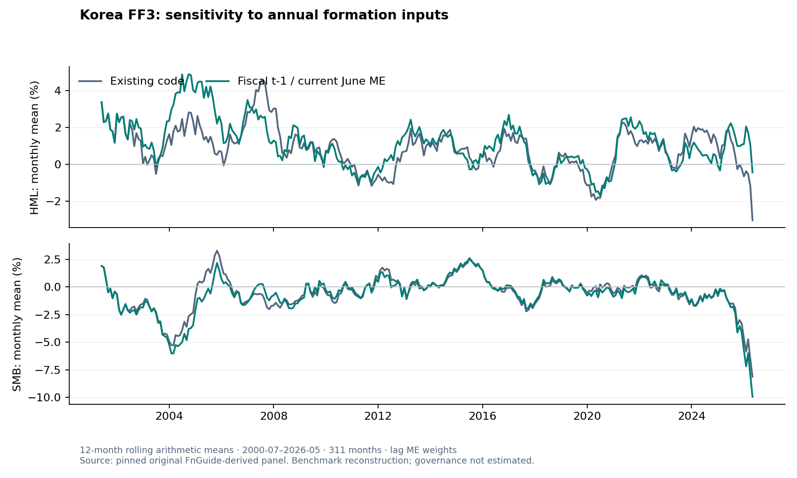

# 공시 기반 거버넌스 × 한국 FF3

**같은 가치주 집단 안에서 거버넌스 정보가 수익률을 추가로 구분하는가?**

한국 Fama–French 3요인 연구를 공시 기반 거버넌스 지표로 확장하는 개인 연구입니다. 기존 FF3의 가치 프리미엄을 재현하고, 공시 공개일·결측·단위·근거를 검수한 뒤 BM 내부의 G 차이와 FF3 조정 알파를 검정하도록 구성했습니다.

**현재: 기초 FF3 재현 완료 · 공시 수집/PIT/통계 검증 코드 구현 · G 실증 미추정 (`limited / fallback_c`).**

[연구노트](korea-market/governance-extension/output/RESEARCH_NOTE.md) · [실행 상태](korea-market/governance-extension/output/RESULT_STATUS.json) · [연구 설계](docs/PROJECT_SPEC.md) · [품질 감사](docs/QUALITY_AUDIT.md) · [참고 리서치](references/mirae_research_notes.md)

## 확인한 결과

원본 저장소의 1,054종목 패널과 2000.07~2026.05의 311개월을 사용해 기존 코드의 결과를 재현했습니다.

| 팩터 | 월평균 | t(OLS) | t(HAC, 3개월) |
| --- | ---: | ---: | ---: |
| MKT−RF | +0.7140% | 1.8957 | 1.7530 |
| SMB | −0.6736% | −2.5655 | −2.2721 |
| HML | +0.8264% | 3.8942 | 3.7550 |

이 수치는 **기존 FF3의 재현값**입니다. 거버넌스 전략의 성과가 아닙니다. 원본 6셀 스크립트를 별도 검증 폴더에서 실행한 결과와 소수 수익률을 대조했습니다.

원본의 6월 BE 패널은 `t-2` 회계연도 값을 갖고, 6월 `panel.bm`은 이전 구성연도의 BM을 담고 있습니다. 문서상 `t-1` 장부자본/당해 6월 시총으로 다시 구성하면 HML 월평균 1.1441%, SMB −0.8222%가 됩니다. 두 계산을 함께 보존해 구성 규약의 영향을 보여줍니다. 새 계산도 실제 재무공시 공개일이 확인된 장기 PIT 백테스트로 주장하지 않습니다.



## 구현한 기능

- **공시 근거 수집:** 공식 OpenDART의 이사 수·독립(사외)이사 수, 접수번호, 공시목록의 공개일, 원응답 해시와 실패 사유.
- **정보 시점 검증:** 공시일 다음 날부터 도달하는 월말 이후에만 사용. 정정공시, 과거 기간 정정, 오래된 관측, 코드 매핑 예외 처리.
- **팩터 검정:** BM 내부 G 소팅, EW/VW, 자기금융 스프레드와 롱온리 RF 구분, FF3 OLS·Newey–West HAC, 공통 연속 표본과 신뢰구간.
- **검증과 보고:** 셀 표본·가중합·결측 확인, 사전 지정 민감도, CSV와 연구노트, 원본 전후 SHA-256 대조. **33개 테스트 통과.**

G는 종합 ESG 점수가 아니라 **독립(사외)이사 비중 대리지표**입니다. 높은 비중이 실제 독립성이나 주주권 보호를 보장하지 않으므로 그룹을 HighG/LowG로 표시합니다. 합성 데이터는 테스트에만 사용합니다.

## 재현

Python 3.12와 git을 사용합니다. 기존 원자료를 이 저장소에 다시 배포하지 않고 고정 커밋에서 읽습니다.

```bash
python -m venv .venv
source .venv/bin/activate
python -m pip install -r requirements.txt
bash scripts/reproduce.sh
python -m pytest -q korea-market/governance-extension/tests
```

실행 코드는 약 10초 이내에 감사·기초 팩터·도표·보고서를 생성했습니다. 최초 의존성 설치와 원본 내려받기 시간은 환경에 따라 달라집니다. 원본 커밋이 다르면 실행을 중단합니다. `.cache/ff3-source`는 읽기 전용 입력으로 취급합니다.

## G 실증을 진행하려면

현재 DART 인증키·법인코드 매핑·과거 G 관측과 재무공시 공개일 근거가 없어 G 수익률 및 알파를 계산하지 않았습니다. 점검 종료와 데이터 확보는 별개 조건입니다.

키는 환경변수 `DART_API_KEY`에만 설정합니다. 키를 파일·명령 인자·커밋에 넣지 않습니다. 공식 법인코드 CSV가 있으면 다운로드 점검 기간에도 `--corp-map`으로 제공할 수 있습니다.

```bash
cd korea-market/governance-extension
python -m src.collect_governance --corp-map data/corp_map.csv \
  --start-year 2015 --end-year 2025 --cutoff 2026-10-09 --max-requests 500
python -m src.pipeline --source ../../.cache/ff3-source \
  --governance data/processed/governance_observations.csv \
  --financial-filings data/financial_filings.csv
```

CSV 필드와 데이터 조건은 [데이터 사전](docs/DATA_DICTIONARY.md)을 따릅니다. 수집은 요청 한도·오류에서 종료하고, 누락 공시를 0으로 채우지 않습니다. 실제 source 응답과 공시 날짜를 직접 검수한 자료를 제공해야 하며 출처 문자열만 채운 CSV를 증빙으로 간주해서는 안 됩니다.

배당 반영, 시장구분, 역사적 상장/상폐 유니버스, 업종·수익성 통제와 거래비용은 아직 검증하지 못했습니다. 따라서 G 자료가 추가되어도 현재 구현은 제한된 탐색 연구로 보고하며 인과관계를 주장하지 않습니다. GRS와 25개 포트폴리오 전체 재현은 이번 후속연구의 완료 범위에 포함하지 않습니다.

## 자료와 연구 관계

- 기초 연구: [Fama-French(1993) 재현·한국 시장 FF3 실증](https://github.com/bucheoncityboy/fama-french-integrated-research), 고정 커밋 `81f3bd921ffcb4ea84c19123d798fbcb830ee9e3`.
- 설계 참고: 미래에셋증권의 거버넌스 위험·PBR×G·VFS·ESG 레이팅·공시 분석 연구. [요약과 확인 수준](references/mirae_research_notes.md)을 보관했습니다.
- 공시 원천: [공식 OpenDART 개발가이드](https://opendart.fss.or.kr/guide/detail.do?apiGrpCd=DS002&apiId=2020012).

기존 미국/한국 연구 파일을 수정하지 않고 독립 저장소로 구현했습니다. 본 프로젝트는 미래에셋증권과 제휴하거나 해당 회사가 발간한 연구물이 아닙니다.
