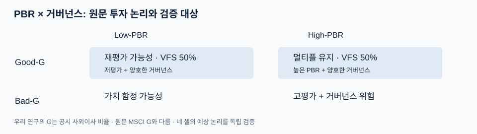
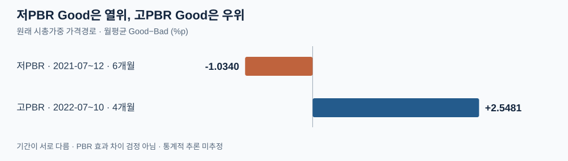
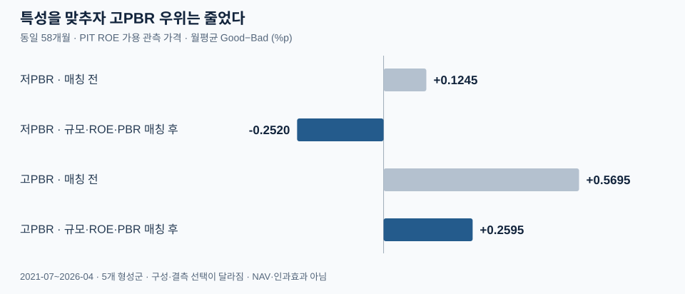
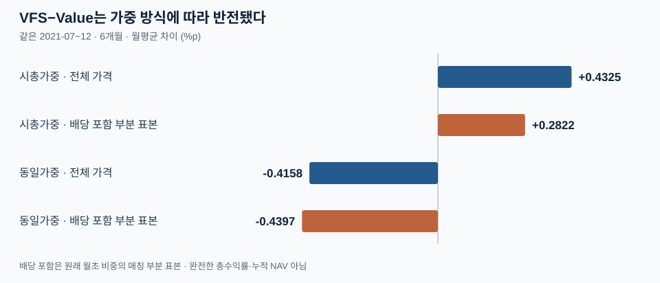

# 거버넌스는 PBR에 추가적인 투자 정보를 제공하는가?

미래에셋 VFS 투자 아이디어에 대한 독립 실증 연구 · 2026-10-12

## Executive Summary

| 검증하려는 주장 | 핵심 실증 | 판단 |
| --- | --- | --- |
| 같은 PBR 구간에서 Good이 우세한가? | 가격 Good−Bad: 저PBR -1.0340%p/월(6개월), 고PBR +2.5481%p/월(4개월) | 방향이 일관되지 않으며 기간도 다름 |
| 유사한 기업 특성에서도 차이가 남는가? | 58개월 관측 단면: 저PBR +0.1245 → -0.2520, 고PBR +0.5695 → +0.2595%p/월 | 매칭 표본에서 저PBR 음수·고PBR 양수 |
| 투자 구현에 견고한가? | VFS−Value: 시총가중 +0.4325, 동일가중 -0.4158%p/월 | 가중 방식에 민감; 배당 포함은 부분 표본 |

같은 PBR 집단 안에서 Good의 상대성과는 저PBR의 짧은 연속 가격경로에서 음수, 고PBR에서는 양수였으며, 두 기간은 서로 다르다. 동일한 58개월 관측 단면에서 규모·PIT ROE·PBR을 맞추자 저PBR 차이는 음수로 바뀌고 고PBR의 양의 차이는 줄었다. FnGuide 배당 포함 부분 표본은 시총가중 상대성과의 방향을 유지했지만, VFS−Value는 동일가중에서 음수였고 모든 보유 종목의 총수익률은 확보되지 않았다. 따라서 고PBR의 일부 양의 차이는 관측됐지만, 원문의 Good 중심 투자 논리를 전 PBR 구간의 일관된 선별 효용이나 거버넌스 고유 효과로 확인하지 못했다.

## 01. Research Thesis & Design

미래에셋증권 유건호 연구원의 「멀티플 탈출」(2026-05-28)은 PBR과 MSCI Governance Score를 결합해 저평가·양호 거버넌스 기업의 재평가와 고PBR·양호 거버넌스 기업의 멀티플 유지 가능성을 제시했다. 원문의 VFS는 Low-Good과 High-Good에 각각 50%를 배분하고 연간 리밸런싱하며, 셀 내부 종목별 25%·최종 종목별 12.5% 상한을 적용한다.

우리는 “같은 PBR 구간에서 거버넌스가 규모·수익성과 별개로 더 나은 투자 결과를 구분하는가?”를 검증한다. G는 MSCI 점수 대신 공시된 **사외이사/전체 이사 비율**이다. 기존 검증 PIT 패널의 6월 말 정보로 7월에 형성하고, 형성 모집단의 PBR 중앙값 이하를 Low, 각 PBR 내 G 중앙값 초과를 Good으로 분류한다. 중앙값 동률은 각각 Low·Bad에 둔다. 네 셀은 시총가중에 25% 상한을 적용한 뒤 다음 형성까지 비중을 자연 변동시키며, VFS는 Good 두 셀에 50:50을 배분한다. Value는 전체 Low를 시총가중한다. 비용 차감 전 가격수익률을 사용하고 보유 결측 발생 시 해당 연간 경로를 중단한다.

공동 PIT 검증이 가능한 형성군은 2021–2025년의 5개 연간 형성군이다. 782개 고유 기업의 58개월 관측 단면과, 결측 없이 이어지는 저PBR 6개월·고PBR 4개월·VFS 비교 6개월의 가격경로를 구분한다. 새 재무자료는 공시일이 확인되지 않아 선정·통제에 쓰지 않았다. 규모·ROE 비교는 기존 PIT를 재사용하고, FnGuide는 배당 포함 수익률 민감도와 기존 가격 이상 확인에만 사용했다. 모든 보완은 기존 결과를 알고 진행한 탐색이며 독립 사전등록·OOS가 아니다.

## 02. Empirical Findings

### Finding 1. 서로 다른 기간에 저PBR Good은 열위, 고PBR Good은 우위였다.

**저PBR 연속 가격경로에서는 Good이 Bad보다 부진했고, 고PBR의 다른 연속기간에서는 Good이 우세했다.** 같은 형성 PBR 집단의 Good/Bad를 원래 시총 비중·연간 보유 규칙으로 비교한 결과다.

| 공통 연속 가격기간 | Good 누적 | Bad 누적 | Good−Bad 월평균 | 형성 기업 Good / Bad | 보유 기업-월 Good / Bad |
| --- | --- | --- | --- | --- | --- |
| 저PBR · 2021-07~12 · 6개월 | -14.38% | -9.05% | -1.0340%p | 150 / 183 | 900 / 1,098 |
| 고PBR · 2022-07~10 · 4개월 | 2.59% | -7.47% | +2.5481%p | 124 / 177 | 496 / 708 |

두 연속기간은 **같은 시장월이 아니므로 PBR 수준에 따른 효과 차이를 통계적으로 입증하지 않는다.** 같은 2021-07~2026-04의 58개월을 쓰는 별도 종목 평균 단면에서는 저PBR +0.1315%p/월, 고PBR +0.4678%p/월이었다. 저PBR의 짧은 가격경로와 부호가 다르다. 이 단면은 매월 관측된 기업의 동일 평균으로 계산하며, 원래 시총 비중·결측 후 중단을 따르는 연속 가격경로와 기간·가중치·표본이 다르다. 결측 관측을 제외한 58개월을 투자 가능한 NAV로 연결하지 않았다.

### Finding 2. 유사 특성 표본에서 고PBR의 관측 차이는 작아졌다.

**같은 58개월 관측 단면에서 특성이 유사한 기업 짝으로 표본을 제한하자 고PBR의 양의 차이가 줄고 저PBR의 차이는 음수로 바뀌었다.** Good은 원래 더 큰 기업으로 구성돼 있어 G만의 정보를 읽기 어렵다.

| 형성 특성 · 기업 단순 요약 | Low-Good · 2021-07 | Low-Bad · 2021-07 | High-Good · 2022-07 | High-Bad · 2022-07 |
| --- | --- | --- | --- | --- |
| PBR 중앙값 | 0.687 | 0.677 | 1.416 | 1.433 |
| 시총 중앙값 · 십억원 | 496.40 | 209.26 | 1175.62 | 245.57 |
| PIT ROE 평균 / 가용 기업 수 | 2.48% / 148 | 2.61% / 182 | 3.10% / 120 | -1.86% / 170 |

같은 형성연도·PBR 집단 안에서 규모 차이 2배 이내, PIT ROE 차이 5%p 이내, PBR 차이 1.5배 이내인 Good/Bad를 짝지었다. 허용된 짝의 정규화 거리 합이 작은 순서로, 수익률을 보지 않고 1:1·중복 없이 매칭했다. 결측 ROE를 양쪽에서 제외했으며 기준을 결과에 맞춰 바꾸지 않았다. 비교 전후 모두 **2021-07~2026-04의 같은 58개월**이고, 월별 동일 평균 차이를 다시 월 단순 평균했다.

| 58개월 관측 가격 단면 | 매칭 전 · PIT ROE 가용 표본 | 매칭 후 · 양쪽 가격 가용 짝 | 5개 형성군의 짝 수 | 관측 짝-월 / 기대 짝-월 |
| --- | --- | --- | --- | --- |
| 저PBR | +0.1245%p/월 | -0.2520%p/월 | 438 | 5,034 / 5,076 |
| 고PBR | +0.5695%p/월 | +0.2595%p/월 | 331 | 3,816 / 3,852 |

형성연도별 log(시총)·ROE·log(PBR)의 매칭 후 절대 표준화 평균차는 모두 **0.076 이하**였다. 이는 관측 특성의 평균 불균형이 작아졌다는 확인이며, 업종 등 미관측 차이가 없어졌다는 뜻은 아니다. 매칭 전 표본은 ROE 가용 기업이라 앞의 전체 단면(+0.1315 / +0.4678)과도 다르다. 매칭 전후는 동일 기간·PIT 가용성 기준을 공유하지만 기업 구성은 달라지고, 매칭 후에는 두 기업의 가격이 모두 관측된 짝만 월 평균에 쓴다. 이 때문에 차이의 축소를 규모·ROE가 설명한 인과적 비율로 계산하지 않는다.

고PBR의 잔여 +0.2595%p/월은 양의 관측 차이로 남지만, 독립적인 거버넌스 효과를 의미하지는 않는다. 저PBR에서는 이 방법으로 Good 우위를 확인하지 못했다. 5개 연간 형성군에서 반복 관측한 기술통계로, 유의한 알파·인과효과·완성된 매칭 전략 성과가 아니다. [매칭 월별 결과](../outputs/supplement/matching_monthly.csv) · [형성군별 균형과 표본 수](../outputs/supplement/matching_balance.csv).

### Finding 3. 배당 포함 부분 표본에서도 가중 방식의 영향은 남았다.

**VFS−Value와 고PBR Good−Bad의 차이는 가중 방식에 민감하며, 배당 포함 자료는 부분 표본에서만 확인됐다.** 원래 2021-07~12의 VFS 누적 가격수익률은 −11.14%, Value −13.72%, KOSPI −10.50%였다. VFS는 Value보다 손실이 작았지만 시장보다 부진했다. VFS−Value 월평균은 시총가중 +0.4325%p, 동일가중 -0.4158%p로 반전됐다. 새로 같은 고PBR 4개월을 동일가중으로 재계산해도 Good−Bad가 -0.6959%p로 바뀌었다. 기업규모와 비중이 해석에 중요하다는 근거다.

FnGuide의 **KR_return_cash_dividend_included_pct**를 100으로 나눠 사용하고, **원래 종목·기간·가격경로의 월초 비중을 고정**했다. 전부 매칭되지 않아 각 셀·전략별 매칭 종목의 원래 비중을 다시 100%로 환산한 조건부 월평균만 계산했다. 같은 부분 표본의 기존 가격수익률을 옆에 두어 표본 변경과 수익률 기준 변경을 구분한다.

| 비교 · 원래 공통기간 | 가중 | 전체 기존 가격 차이 | 같은 부분 표본 가격 차이 | 부분 표본 배당 포함 차이 | 종목-월 매칭 | 최저 원래 비중 커버리지 |
| --- | --- | --- | --- | --- | --- | --- |
| 저PBR · 6개월 | 시총 | -1.0340 | -0.8991 | -0.7958 | 1,926/1,998 | 94.09% |
| 저PBR · 6개월 | 동일 | -1.2425 | -1.1321 | -1.0339 | 1,926/1,998 | 94.81% |
| 고PBR · 4개월 | 시총 | +2.5481 | +2.5500 | +2.5957 | 1,184/1,204 | 99.10% |
| 고PBR · 4개월 | 동일 | -0.6959 | -0.6937 | -0.6891 | 1,184/1,204 | 98.21% |
| VFS−Value · 6개월 | 시총 | +0.4325 | +0.4307 | +0.2822 | 3,744/3,864 | 98.15% |
| VFS−Value · 6개월 | 동일 | -0.4158 | -0.3703 | -0.4397 | 3,744/3,864 | 96.09% |

모든 차이는 %p/월이며, 커버리지는 비교하는 두 집단의 각 월 중 최저값이다. **배당 포함 열은 완전한 포트폴리오 수익률·누적 NAV가 아니다.** 시총가중 부분 표본의 저PBR 음수·고PBR 양수·VFS−Value 양수 방향은 유지됐고, 동일가중에서는 VFS−Value 음수도 유지됐다. 결측 종목의 수익률에 따라 전체 결과가 달라질 수 있어 부분 표본의 부호를 전체 총수익률의 검증으로 확대하지 않는다. 기존 가격과 새 수익률의 차이는 데이터 정의·가격 조정 차이도 포함할 수 있다.

매칭된 기업 짝에 배당 자료까지 있는 같은 월별 부분 표본에서도 저PBR은 가격 -0.2548 → 배당 포함 -0.2538%p/월(4,793 짝-월), 고PBR은 +0.1702 → +0.1781%p/월(3,644 짝-월)로 부호가 유지됐다. 이는 같은 매칭 방법의 수익률 기준 민감도이며 추가 전략이 아니다.

## 03. Conclusion

현재 자료에서 **PBR에 거버넌스를 더한 선별이 모든 PBR 구간에서 일관되게 유용했다고 판단할 수 없다.** 저PBR에서는 원래 연속 가격경로의 Good 열위와 매칭 후 음의 차이가 함께 나타났다. 고PBR에서는 양의 차이가 관측됐고 규모·PIT ROE·PBR을 맞춘 뒤에도 일부 남아, 일부 양의 수익률 차이가 관측된다. 다만 매칭 후 차이가 줄고 동일가중 민감도에서 부호가 바뀌어, 그 우위를 거버넌스 고유 효과로 인정할 근거는 충분하지 않다.

배당 포함 부분 표본은 이 판단을 뒤집지 않았다. 시총가중 VFS의 Value 대비 차이는 같은 매칭 부분 표본에서 양수였지만 동일가중에서는 음수였고, 전체 보유 종목의 총수익률은 확인되지 않았다. 따라서 **거버넌스 프록시를 규모·수익성과 독립된 보편적 선별 기준으로 정당화하기에는 증거가 부족하며, 고PBR의 잔여 차이도 독립적인 정보 가치의 증거로 단정할 수 없다.** 이 판단은 사외이사 비율·선택된 한국 기업·관측기간에 한정된다. MSCI G, 2016~2020년 PIT 공백, 상폐·합병 대가와 거래 가능성, 독립 OOS 및 장기 알파는 미검증이다.

## Appendix

기존 결과·설계·원천 감사는 보존했다. 본문은 단일 연구 질문에 집중하며, 상세 기술자료는 다음 링크에서 확인할 수 있다.

[보완 분석 방법·재현](../docs/SUPPLEMENT_REPRODUCIBILITY.md) · [기존 설계 잠금](../config/vfs_pre_analysis_plan.yaml) · [결과 보기 전 고정한 보완 규칙](../config/supplement_plan.json) · [기존 4셀 결과](../outputs/core_hypotheses/hypothesis_results.json) · [상세 강건성](../outputs/robustness.csv) · [기업행동 감사](../docs/ECONOMIC_RETURN_RECOVERY.md) · [원천 검증](../docs/PUBLIC_SOURCE_REBUILD.md) · [기존 상세 대시보드](../dashboard/appendix.html) · [2026-10-11 핵심 분석 보존 페이지](../dashboard/core-archive.html) · [면접 요약](../docs/INTERVIEW_BRIEF.md) · [GitHub Pages](https://bucheoncityboy.github.io/mirae-governance-vfs-research/)

Value와 동일 조건으로 비교하는 공통 연속 기간은 2021-07~2021-12(6개월)입니다. 이 기간 누적 가격수익률은 VFS -11.14%, Value -13.72%, KOSPI -10.50%이며, VFS−Value 월평균 차이는 +0.43%p입니다.
